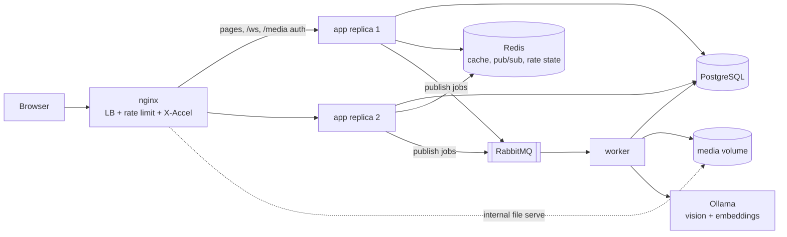
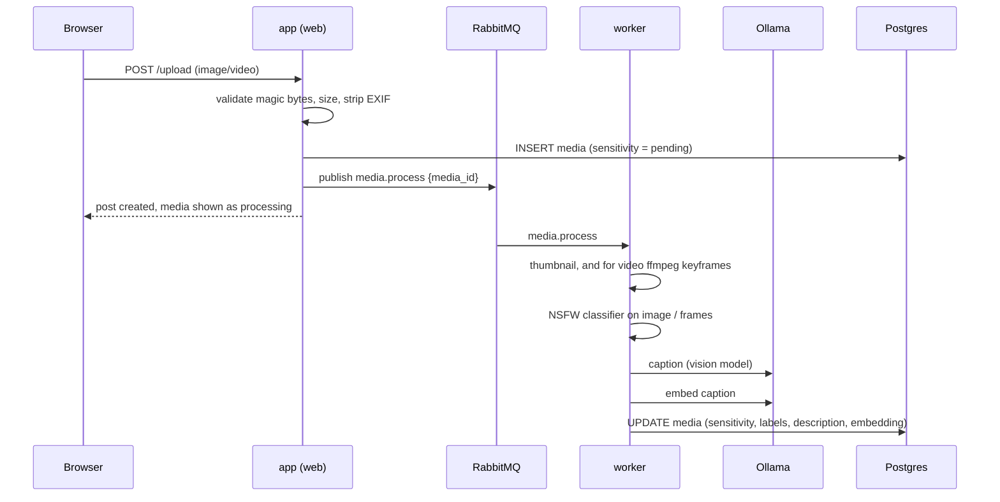

# yourspace

A self-hosted social platform written in Rust. Server-rendered HTML, threaded posts, reposts and stories, public / friends-only / private visibility for each part of an account and for each individual post, notifications, media with automatic sensitive-content filtering, realtime chat, and a mod/admin toolset. Anyone can browse public content without an account. Everything runs in Docker.

---

## 1. Decisions at a glance

| Question | Decision | Why |
|---|---|---|
| Database | **PostgreSQL** (+ `pgvector`, `pg_trgm`) | Your data is relational. Follows are a 1-hop edge table, threads are a `parent_id` tree. Postgres also gives you full-text search, vector search, transactions for counters/polls and one thing to back up. Neo4j adds a second store that must be kept in sync, for graph queries you don't have yet. |
| Neo4j? | **Not now** | Revisit only for "people you may know" / graph recommendations at very large edge counts. It can be added later as a read-only projection fed from Postgres. |
| Message queue | **RabbitMQ for background jobs only** | Moderation, captioning, embeddings, thumbnails, transcoding. Not for chat delivery. |
| Realtime chat | **WebSocket on the app + Redis pub/sub** | App is horizontally scaled, so a message received by replica A must reach a user connected to replica B. Messages are persisted in Postgres first, then published. |
| Cache | **Both, layered**: `moka` (in-process L1) + **Redis** (shared L2) | L1 is nanoseconds but per-replica. L2 is shared across replicas and also holds rate-limit state and pub/sub. See §6. |
| Load balancer | **nginx** (don't write your own) | Battle-tested, handles WebSocket upgrade, rate limiting, caching and `X-Accel-Redirect` file serving. |
| Frontend | **Server-rendered HTML (Askama templates) + HTMX** + small vanilla JS | Matches your "render and send" goal. JS only for emoji autocomplete, tag chips, WebSocket glue. |
| Media storage | **Shared Docker volume**, served by nginx | Simple. Switch to MinIO/S3 when you outgrow a single host. |
| Media/AI | **Ollama**: vision model for captions + text embedding model for search | Plus a dedicated NSFW classifier for the actual hide/show decision (see §7). |
| Anonymous browsing | **Allowed**, read-only, public content only | Logged-out visitors see what the visibility rules allow (§3.3). Responses for visitors without a session cookie can be cached by nginx (§6). |
| Privacy model | **Three levels (`public`, `friends`, `private`) per account section and per post** | No public/private account switch. The account setting is the ceiling and an individual post can only narrow it, so `private` posts setting + `public` post = private (§3.2). |
| Notifications | **Own `notifications` table + bell popup, separate from chat** | Chat has its own icon and unread badge, so message floods never bury replies or requests. Repeated events are grouped (§8.2). |
| Trending | **Separate page from Discover** | Trending is the same for everyone and cheap to cache; Discover is exploratory and personalized when logged in (§4.3). |
| Limits and flags | **Global limits and feature flags in `.env`** | Video 50 MB / 10 min, image 50 MB, plus switches for heavy parts such as the AI moderation worker (§13). |
| Friends | **Derived, not stored** | Two accepted follows in opposite directions. No extra table to keep in sync (§3.4). |
| Block / mute | **Separate `blocks` and `mutes` tables** | Block hides everything in both directions, mute only quiets feeds and stories (§3.5). |
| Reports | **`reports` table + mod queue** | Users report posts, AI flags land in the same queue (§7). |

---

## 2. Architecture



Two Rust binaries in one Cargo workspace:

- **`web`**: axum HTTP + WebSocket, renders HTML, enforces auth/roles, publishes jobs.
- **`worker`**: consumes RabbitMQ, calls Ollama / ffmpeg, writes results to Postgres.

Suggested crates: `axum`, `tokio`, `tower-http`, `sqlx` (Postgres, compile-time checked), `askama`, `pulldown-cmark` + `ammonia` (markdown, sanitized), `argon2`, `lapin` (RabbitMQ), `redis`/`deadpool-redis`, `moka`, `reqwest` (Ollama), `image`, `tracing`.

---

## 3. Roles, privacy and visibility

### 3.1 Roles and permissions

| Action | user | mod | admin |
|---|:--:|:--:|:--:|
| Post, reply, like, follow, vote, chat | ✅ | ✅ | ✅ |
| Edit/delete **own** posts, profile, settings | ✅ | ✅ | ✅ |
| See view-deleted posts | ❌ | ✅ | ✅ |
| View-delete any post (soft delete) | ❌ | ✅ | ✅ |
| Restore a view-deleted post | ❌ | ✅ | ✅ |
| Hard-delete a post (row removed) | ❌ | ❌ | ✅ |
| Admin panel | ❌ | ❌ | ✅ |
| Edit any account (name, bio, pic, role, suspend), see who they follow | ❌ | ❌ | ✅ |
| See extra post info (IP/session, moderation labels, audit trail) | ❌ | ❌ | ✅ |
| Repost, post stories, block / mute accounts | ✅ | ✅ | ✅ |
| Report a post | ✅ | ✅ | ✅ |
| Review the report queue and AI-flagged posts, resolve or dismiss reports | ❌ | ✅ | ✅ |
| View-delete a story | ❌ | ✅ | ✅ |
| See things an account restricted to `friends` or `private` (when not a friend) | ❌ (own account and friends only) | ❌ | ✅ |
| Send site announcements and system notices | ❌ | ❌ | ✅ |

**View-delete** = `posts.deleted_at` is set. Normal queries use the `public_posts` view (`deleted_at IS NULL`); mods and admins query `posts` directly. **Hard delete** removes the row; `ON DELETE CASCADE` cleans up replies, likes, tags, media links. Every mod/admin action writes to `audit_log`.

Mods are ordinary users when it comes to **restricted** content (the "friends / private" row above). They can still act on a specific post that reaches them through the report queue or an AI flag, but only that post.

Role and visibility checks are enforced in one place (an axum extractor plus a single `Viewer` value, `Anonymous | User { id, role }`, passed into every query function), never only in templates and never re-implemented per handler.

### 3.2 Visibility levels

Every restrictable thing has one of three levels (`visibility_level` enum):

| Level | Who can see it |
|---|---|
| `public` | Everyone, including anonymous visitors |
| `friends` | The owner and their **friends** (mutual accepted follows, §3.4) |
| `private` | The owner only (admins can still see it) |

**Account sections.** Each section has its own level in `user_privacy`: `posts_visibility`, `likes_visibility`, `follows_visibility` (the followers / following lists), `reposts_visibility` and `stories_visibility`. They are independent, so an account can have public posts, friends-only likes and private follows. Name, username, bio, **avatar** and date joined are always visible to everyone who has not been blocked.

There is no separate "private account" switch. A "private account" is simply every section set to `private`; the registration page offers that as a preset (below).

**Per-post visibility.** Each post also has its own `visibility` (`public | friends | private`), chosen in the composer and editable later. It is a different thing from the account setting, and they combine like this: **the account setting is the ceiling, and a post can only narrow it, never widen it.** The effective visibility is the stricter of the two:

| Account `posts_visibility` | Post `visibility` | Effective |
|---|---|---|
| public | public | public |
| public | friends | friends |
| public | private | private |
| friends | public | **friends** |
| friends | private | private |
| private | public | **private** |
| private | friends | **private** |

So an account whose posts are `private` only has private posts, even if every single post is marked public. Effective visibility is computed at read time, so changing the account setting later applies to every existing post immediately, without rewriting rows. Replies follow the same rule (a reply is a post with its own `visibility`). New posts default to `public`, which means the account setting alone decides unless the author narrows a specific post.

**Reposts and likes.**

- Only posts whose effective visibility is `public` can be reposted. A repost is listed according to `reposts_visibility`, and only to viewers who can also see the original.
- `likes_visibility` controls who can see which posts a user has liked, and their entry in a post's likers list. Like counts stay visible.

**Follow approval** (`require_follow_approval`, default off) is a separate setting, see §3.4.

**Registration.** Right after sign-up the user is redirected to `/welcome/privacy`. Until that page is submitted (`privacy_onboarded = false`) every section behaves as `private` and logged-in navigation keeps redirecting there, so nothing is exposed if someone closes the tab. The page offers three presets (**Public**, **Friends only**, **Private**) that fill all five section selectors plus the follow-approval checkbox, and each selector can then be changed individually. Presets are UI only and are not stored.

**Future features.** When a new section is added later, its column is backfilled with the **strictest** level among the account's existing sections, so nobody is exposed by a feature they never saw. Everyone can change it afterwards.

### 3.3 Who can see what

| Viewer | Always visible (name, username, bio, avatar, joined) | `public` | `friends` | `private` |
|---|:--:|:--:|:--:|:--:|
| Owner | ✅ | ✅ | ✅ | ✅ |
| Admin | ✅ | ✅ | ✅ | ✅ |
| Friend (mutual accepted follow) | ✅ | ✅ | ✅ | ❌ |
| Any other logged-in user, **including mods** | ✅ | ✅ | ❌ | ❌ |
| Anonymous visitor | ✅ | ✅ | ❌ | ❌ |
| Blocked either way (§3.5) | ❌ (profile not found) | ❌ | ❌ | ❌ |

A user who follows you but is not your friend counts as "any other user": they only see your `public` things.

One predicate, `can_view(viewer, owner, level)`, is applied everywhere: profile tabs, feeds, trending, search, discover, direct post links and thread pages. For posts, `level` is the effective visibility from §3.2. A thread page requires being able to view the thread's root post. Replies the viewer may not see are shown as a collapsed "hidden reply" placeholder so the tree keeps its shape. Counters (like count, repost count, follower count) stay visible; the *lists* behind them follow the levels.

### 3.4 Following, approval and friends

- `follows.status` is `pending` or `accepted`. Following an account without approval inserts `accepted` directly. With approval it inserts `pending` and the button shows "Requested" (cancelling deletes the row).
- The owner handles requests in `/follow-requests` (or inline in the notifications popup, §8.2). Accept sets `accepted`, decline deletes the row. Pending follows do not count in `follower_count` / `following_count`.
- **Turning approval on** does not touch existing followers.
- **Turning approval off** opens a dialog about requests that are still pending, with three radio buttons: **Stay pending** (default), **Reject all** and **Accept all**.
- **Friends** = two `accepted` follows in opposite directions. It is derived by query (the `follows (followee_id, follower_id)` index already covers it), shown as a "Friends" badge, and powers the `friends` visibility level and the **Friends feed** (§4.3). Unfollowing or blocking ends the friendship, and anything the other person could see only as a friend becomes hidden from them again.

### 3.5 Block and mute

| | Mute | Block |
|---|---|---|
| Direction | One-way (muter stops seeing the muted account's content) | Both directions: neither side can see the other |
| Posts and stories | Hidden from feeds, discover, search and the story tray | Hidden everywhere |
| Replies in threads | Still shown | Hidden: you cannot see them in a comment section, and they cannot see yours |
| Profile | Still visitable | Not visitable (behaves as not found) |
| Follows | Kept | Removed in both directions, and neither can follow again |
| Chat | Unaffected | No new DMs in either direction; any existing conversation is hidden from the blocker and read-only for the blocked user |
| Notified | No | No |
| Notifications | Still created (§8.2) | Never created in either direction |

Implementation: every query that returns posts, stories, users or messages goes through the same `Viewer` filter, which does `NOT EXISTS` against `blocks` (and `mutes` for feeds). Each user's block and mute ID sets are cached in Redis and invalidated on change. Cached post fragments stay viewer-agnostic; the filtering happens before rendering (§6).

### 3.6 Anonymous visitors

Logged-out users can browse public content: home and discover feeds, public profiles, post and thread pages, tags and search. They are read-only (no likes, follows, reposts, polls, chat). They only ever see `public` things (§3.3). Visitors have no settings, so **sensitive media is hidden by default** and can be revealed with the "show" button. Anonymous traffic is rate limited per IP like any other page request (§9).

---

## 4. Data model

### 4.1 ER diagram

```mermaid
erDiagram
    USERS ||--|| USER_SETTINGS : has
    USERS ||--o{ SESSIONS : has
    USERS ||--o{ MEDIA : uploads
    USERS ||--o{ POSTS : writes
    USERS ||--o{ STICKERS : creates
    USERS ||--o{ LIKES : gives
    USERS ||--o{ FOLLOWS : "follower"
    USERS ||--o{ FOLLOWS : "followee"
    USERS ||--o{ POLL_VOTES : casts
    USERS ||--o{ CONVERSATION_MEMBERS : joins
    USERS ||--o{ MESSAGES : sends
    USERS ||--o{ AUDIT_LOG : "acts in"

    USERS ||--|| USER_PRIVACY : has
    USERS ||--o{ REPOSTS : makes
    POSTS ||--o{ REPOSTS : "reposted via"
    USERS ||--o{ STORIES : posts
    STORIES }o--|| MEDIA : uses
    STORIES ||--o{ STORY_VIEWS : "seen via"
    USERS ||--o{ STORY_VIEWS : views
    USERS ||--o{ BLOCKS : "blocker"
    USERS ||--o{ BLOCKS : "blocked"
    USERS ||--o{ MUTES : "muter"
    USERS ||--o{ MUTES : "muted"
    USERS ||--o{ REPORTS : files
    POSTS ||--o{ REPORTS : "reported in"

    USERS ||--|| NOTIFICATION_SETTINGS : has
    USERS ||--o{ NOTIFICATIONS : receives
    USERS ||--o{ NOTIFICATIONS : "causes"
    POSTS ||--o{ NOTIFICATIONS : "about"
    USERS ||--o{ ANNOUNCEMENTS : writes

    POSTS ||--o{ POSTS : "parent of"
    POSTS ||--o{ LIKES : receives
    POSTS ||--o{ POST_MEDIA : has
    MEDIA ||--o{ POST_MEDIA : "attached via"
    POSTS ||--o{ POST_STICKERS : has
    STICKERS ||--o{ POST_STICKERS : "used in"
    STICKERS }o--|| MEDIA : "image is"
    POSTS ||--o{ POST_TAGS : has
    TAGS ||--o{ POST_TAGS : "applied via"
    POSTS ||--o| POLLS : "may be"
    POLLS ||--o{ POLL_OPTIONS : has
    POLL_OPTIONS ||--o{ POLL_VOTES : receives

    CONVERSATIONS ||--o{ CONVERSATION_MEMBERS : has
    CONVERSATIONS ||--o{ MESSAGES : contains
    MESSAGES }o--o| MEDIA : "may attach"
    MESSAGES }o--o| STICKERS : "may use"

    USERS {
        bigint id PK
        citext username UK
        text display_name
        citext email UK
        text password_hash
        text bio
        bigint avatar_media_id FK
        user_role role "user | mod | admin"
        bool is_suspended
        int follower_count
        int following_count
        timestamptz created_at
    }
    USER_SETTINGS {
        bigint user_id PK, FK
        bool hide_sensitive
        text dm_policy
        text language
        text theme
        bool hide_typing_indicator "hides mine and theirs in my chats"
        jsonb extra
    }
    USER_PRIVACY {
        bigint user_id PK, FK
        visibility_level posts_visibility "public | friends | private"
        visibility_level likes_visibility
        visibility_level follows_visibility
        visibility_level reposts_visibility
        visibility_level stories_visibility
        bool require_follow_approval
        bool privacy_onboarded "false until the welcome page is submitted"
    }
    SESSIONS {
        bytea token_hash PK
        bigint user_id FK
        timestamptz expires_at
        inet ip
        text user_agent
    }
    MEDIA {
        bigint id PK
        bigint owner_id FK
        media_kind kind "image | video"
        text mime
        text storage_key UK
        text thumbnail_key
        bigint size_bytes
        int width
        int height
        int duration_ms
        bytea sha256
        sensitivity_state sensitivity "pending | safe | sensitive | blocked"
        jsonb moderation_labels
        text moderation_model
        text description "AI caption, searchable"
        tsvector description_tsv
        vector description_embedding
        timestamptz processed_at
    }
    POSTS {
        bigint id PK
        bigint author_id FK
        bigint parent_id FK "NULL = thread start"
        bigint root_id FK "thread root, set by trigger"
        int depth
        text body_md
        text body_html "sanitized render"
        visibility_level visibility "per post, can only narrow the account setting"
        int like_count
        int reply_count
        int repost_count
        timestamptz created_at
        timestamptz edited_at
        timestamptz deleted_at "view-delete marker"
        bigint deleted_by FK
        text delete_reason
        sensitivity_state sensitivity "worst of text and media verdicts"
        jsonb moderation_labels "raw LLM output"
        text moderation_model
        timestamptz moderation_checked_at
        tsvector search_tsv
    }
    POST_MEDIA {
        bigint post_id PK, FK
        bigint media_id PK, FK
        smallint position
    }
    STICKERS {
        bigint id PK
        bigint owner_id FK "NULL = built-in"
        text name
        bigint media_id FK
    }
    POST_STICKERS {
        bigint post_id PK, FK
        bigint sticker_id PK, FK
        smallint position PK
    }
    TAGS {
        bigint id PK
        citext name UK
    }
    POST_TAGS {
        bigint post_id PK, FK
        bigint tag_id PK, FK
    }
    POLLS {
        bigint post_id PK, FK
        bool allow_multiple
        timestamptz closes_at
    }
    POLL_OPTIONS {
        bigint id PK
        bigint poll_id FK
        text label
        smallint position
        int vote_count
    }
    POLL_VOTES {
        bigint option_id PK, FK
        bigint user_id PK, FK
        bigint poll_id FK
    }
    LIKES {
        bigint user_id PK, FK
        bigint post_id PK, FK
        timestamptz created_at
    }
    FOLLOWS {
        bigint follower_id PK, FK
        bigint followee_id PK, FK
        follow_status status "pending | accepted"
        timestamptz created_at
    }
    REPOSTS {
        bigint user_id PK, FK
        bigint post_id PK, FK
        timestamptz created_at
    }
    STORIES {
        bigint id PK
        bigint author_id FK
        bigint media_id FK
        text caption
        timestamptz created_at
        timestamptz expires_at "created_at plus 24h"
        timestamptz deleted_at "view-delete marker"
        bigint deleted_by FK
    }
    STORY_VIEWS {
        bigint story_id PK, FK
        bigint viewer_id PK, FK
        timestamptz viewed_at
    }
    BLOCKS {
        bigint blocker_id PK, FK
        bigint blocked_id PK, FK
        timestamptz created_at
    }
    MUTES {
        bigint muter_id PK, FK
        bigint muted_id PK, FK
        timestamptz created_at
    }
    REPORTS {
        bigint id PK
        bigint reporter_id FK
        bigint post_id FK
        text reason
        text details
        report_status status "open | resolved | dismissed"
        bigint resolved_by FK
        timestamptz resolved_at
        timestamptz created_at
    }
    CONVERSATIONS {
        bigint id PK
        conversation_kind kind "direct | group"
        text title
        text direct_key UK "prevents duplicate 1:1 chats"
        bigint created_by FK
    }
    CONVERSATION_MEMBERS {
        bigint conversation_id PK, FK
        bigint user_id PK, FK
        bigint last_read_message_id "read receipts"
        bool muted
    }
    MESSAGES {
        bigint id PK
        bigint conversation_id FK
        bigint sender_id FK
        text body
        bigint media_id FK
        bigint sticker_id FK
        timestamptz created_at
        timestamptz deleted_at
    }
    AUDIT_LOG {
        bigint id PK
        bigint actor_id FK
        text action
        text target_type
        bigint target_id
        text reason
        jsonb meta
        timestamptz created_at
    }
    NOTIFICATIONS {
        bigint id PK
        bigint recipient_id FK
        notification_kind kind "follow_request | post_comment | system | ..."
        bigint actor_id FK "NULL for system notices"
        bigint post_id FK "NULL when not about a post"
        text group_key "collapses repeated events"
        int count "events in this group"
        jsonb data "title, body, link"
        timestamptz created_at "latest activity"
        timestamptz read_at
    }
    NOTIFICATION_SETTINGS {
        bigint user_id PK, FK
        bool post_comments
        bool comment_replies
        bool follow_requests
        bool follow_accepted
        bool new_followers
        bool mentions
        bool reposts
        bool likes
        bool poll_results
        timestamptz announcements_seen_at
    }
    ANNOUNCEMENTS {
        bigint id PK
        bigint created_by FK
        text title
        text body_md
        timestamptz created_at
        timestamptz expires_at
    }
```



The full DDL (types, constraints, indexes, thread trigger, `public_posts` view) is in [`schema.sql`](schema.sql). **Note:** `schema.sql` still describes the first version of the model. The tables and columns added in this revision (`user_privacy`, `reposts`, `stories`, `story_views`, `blocks`, `mutes`, `reports`, `notifications`, `notification_settings`, `announcements`, the `visibility_level` and `follow_status` enums, `follows.status`, `posts.visibility`, the `posts` moderation fields, `user_settings.hide_typing_indicator`) have to be added to it.

### 4.2 Modeling notes

- **Threads**: every post has `parent_id` (NULL for a thread start). `root_id` and `depth` are filled by a trigger, so loading a whole thread is one query: `WHERE root_id = $1 ORDER BY created_at`, then build the tree in Rust. No recursive CTE per request. A `depth <= 50` check stops pathological chains.
- **Hidden content descriptions**: stored in `media.description`. The template renders it both as the `alt` attribute and as a visually-hidden element next to the media (readable by crawlers, screen readers and inspect-element).
- **Tags**: stored normalized (`tags` + `post_tags`). The UI turns `#something␣` into a chip with an `[x]` and sends the final tag list as form fields; the server re-parses and validates, so the client is never trusted.
- **Polls**: a poll is a post with a `polls` row. `poll_options.vote_count` is a denormalized counter updated in the vote transaction.
- **Counters** (`like_count`, `reply_count`, `repost_count`, `follower_count`, `following_count`, `vote_count`) are denormalized for fast reads and updated in the same transaction as the row they count. Follower counters count `accepted` follows only.
- **Read receipts**: one `last_read_message_id` per member, not a row per message.
- **Typing indicators** are never stored; they're ephemeral WebSocket events fanned out over Redis pub/sub and throttled.
- **Emojis** are stored as plain Unicode. `:joy:` autocomplete is frontend-only and inserts the Unicode character, so the DB and search need nothing special.
- **Stickers** are `media` rows wrapped by `stickers`, allowed in posts (`post_stickers`) and chat (`messages.sticker_id`).
- **IDs** are `BIGINT` identity columns (small indexes, keyset pagination). If you later want non-enumerable public IDs, add a separate `public_id` column rather than switching primary keys.
- **Privacy**: `user_privacy` is a 1:1 table (one row per user, created at registration in the same transaction; every section starts as `private` until the welcome page is submitted). It is read on almost every request, so it is cached in `moka`/Redis and invalidated on change. Adding a section = new `visibility_level` column, backfilled with the strictest existing level (§3.2).
- **Per-post visibility**: `posts.visibility` (default `public`) holds the author's choice for that post. The effective level is `stricter(user_privacy.posts_visibility, posts.visibility)`, computed at read time, so an account setting change needs no row rewrites. Queries for anonymous visitors, discover and trending filter on `visibility = 'public'` joined to the cached account level; if that join ever becomes a bottleneck, denormalize an `effective_visibility` column and recompute it in a background job when the account setting changes.
- **Follows** carry a `status` (`pending` | `accepted`). A decline or a cancelled request deletes the row. **Friends** are never stored; they are the self-join of two `accepted` rows.
- **Reposts**: a plain `(user_id, post_id)` row, no quote text. Reposts show up in feeds as "X reposted" and in the reposter's profile according to `reposts_visibility`. Only posts whose effective visibility is `public` can be reposted, because a repost would otherwise expose them outside the author's rules. If the original is later restricted, the repost disappears for viewers who can no longer see the original.
- **Stories**: media-only (plus optional caption) posts that expire. `expires_at = created_at + 24h`; readers filter on `expires_at > now()`, and a worker purges expired rows and their media after a retention period. Stories go through the same media pipeline as posts, carry the same `deleted_at` view-delete marker, and `story_views` records who has seen each one.
- **Notifications**: one row per recipient and event, with `kind`, optional `actor_id` / `post_id`, a `data` JSON for display text, `read_at`, and a `group_key` + `count` for grouping. A partial unique index on `(recipient_id, group_key) WHERE read_at IS NULL AND group_key IS NOT NULL` makes the grouping an upsert. A partial index on `(recipient_id) WHERE read_at IS NULL` serves the unread counter. Chat is not stored here (§8.1). Site-wide updates live once in `announcements`.
- **Blocks and mutes**: two small edge tables with composite primary keys and `CHECK (a <> b)`. Block is symmetric in effect but stored once, as `(blocker_id, blocked_id)`.
- **Reports**: one row per `(reporter_id, post_id)` (unique), with `status` `open | resolved | dismissed`. Resolving can trigger a view-delete; both are written to `audit_log`.
- **AI sensitivity flags**: `posts.sensitivity` is the worst verdict across the post's text (LLM text check) and its attached media (`media.sensitivity`), recomputed by the worker whenever a check finishes. `moderation_labels` keeps the raw labels/scores, and `moderation_model` + `moderation_checked_at` record which model decided and when, so verdicts can be re-run after a model change. `sensitive` posts are blurred for users with `hide_sensitive` on; `blocked` posts are withheld from everyone except the owner, mods and admins until reviewed. `sensitive` and `blocked` posts appear in the mod queue next to user reports. Media (and therefore stories and chat media) carries the same fields.

### 4.3 Feeds

| Feed | Query strategy |
|---|---|
| Following | Fan-out **on read**: `posts WHERE author_id IN (accepted followees) ORDER BY id DESC`, keyset pagination. Cache the ID list in Redis for a few seconds. Includes reposts made by followees. |
| Friends | Same as Following, restricted to mutual follows: join `follows` to itself (`a.follower_id = $viewer AND b.followee_id = $viewer AND a.followee_id = b.follower_id AND both accepted`) and take posts by those authors. Only friends' posts, no discover mixing. |
| Discover | Score = likes and replies with time decay, computed by a periodic job into a Redis sorted set. |
| FYP | Later. Start by blending Following + Discover; add personalization once you have engagement data. |

Fan-out on write (precomputed timelines) only becomes worthwhile when accounts have huge follower counts.

Every feed applies the visibility predicate from §3.3 (effective post visibility, `reposts_visibility`) and the viewer's blocks and mutes. A follower who is not a friend therefore only sees `public` posts in the Following feed. Stories are not part of the feeds; they appear in a story tray built from followees with an unexpired story, minus blocked and muted accounts and accounts whose `stories_visibility` doesn't allow that viewer.

**Discover vs Trending.** They answer different questions, so they are separate pages:

- **Discover** is for exploring: suggested accounts, tags and posts you might like. Personalized when logged in (based on who and which tags you follow), and a generic public mix for anonymous visitors.
- **Trending** is "what is blowing up right now" and is the **same for everyone**, which makes it cheap to cache and a good landing page for anonymous visitors. Tabs: **Posts** and **Tags**, with a window selector (last hour / today / this week).

How Trending is computed (a periodic worker job, switchable with `FEATURE_TRENDING_JOB`):

1. Candidates: posts with effective visibility `public`, not view-deleted, not `blocked` by the AI filter.
2. Score: engagement by **distinct users** (likes, reposts, replies, weighted) divided by an age decay, e.g. `engagement / (age_hours + 2)^1.5`.
3. Tags: number of distinct *authors* using the tag in the window compared with the previous window, with a minimum number of distinct authors so one person spamming a tag cannot trend it. An admin-managed banlist can exclude tags.
4. The result is written to Redis sorted sets (e.g. `trending:posts:24h`, `trending:tags:1h`). Per-viewer filtering (blocks, mutes, sensitive-media blur) happens when the list is rendered, never inside the stored result.

---

## 5. Search

1. **Keyword**: `posts.search_tsv` (post text) and `media.description_tsv` (AI captions) with GIN indexes, plus tag matching. Uses the `simple` text-search config so it works for any language; switch to per-language configs if you want stemming.
2. **Semantic**: the worker embeds each caption with an Ollama embedding model (e.g. `nomic-embed-text`, 768-dim, matches `VECTOR(768)`), stored in `media.description_embedding` with an HNSW index. At query time embed the query and merge the top results with keyword results.
3. **CLIP note**: Ollama doesn't serve CLIP-style image-text embeddings well. "VLM caption → text embedding" works fully inside Ollama. True CLIP can be added later in the worker via ONNX (`ort` crate) if caption search isn't good enough.
4. **Videos**: ffmpeg extracts a handful of keyframes; caption those and join the captions.
5. **Who may see a result**: search results go through the same visibility predicate, blocks and mutes as feeds (§3.3, §3.5). Hidden posts, and posts from blocked accounts, are filtered out of results, including the captions and tags derived from them.

---

## 6. Caching

| Layer | What | TTL |
|---|---|---|
| nginx `proxy_cache` | `/static/*` | 1 h |
| nginx `proxy_cache` (anonymous only, **planned**, not in `nginx.conf` yet) | public pages for requests with no session cookie, keyed by URL; bypassed whenever a session cookie is present | 15 s |
| `moka` (in-process, L1) | hot user cards, rendered post fragments, role/settings lookups | 5-30 s |
| Redis (shared, L2) | feed ID lists, counters, discover and trending sets, unread notification counters, block/mute ID sets, rate-limit state, session lookups | seconds to minutes |
| Postgres | source of truth | n/a |

Rules: cache **post fragments** keyed by `(post_id, edited_at)` and apply per-viewer concerns (sensitive-media blur, view-delete visibility) at render time, not inside the cached fragment. Invalidate on edit/delete by deleting the key and publishing an invalidation on Redis pub/sub so every replica drops its L1 copy.

---

## 7. Media upload and moderation pipeline



- **Pending media is hidden from everyone but the owner** until classified. No window where unmoderated content is publicly visible.
- **Hide-for-users-who-enabled-it**: if `user_settings.hide_sensitive` is true and `media.sensitivity = 'sensitive'`, the server renders a placeholder with a "show" button (HTMX swap) and **does not send the bytes**. `/media/:id` is the enforcement point: the app authorizes, then replies with `X-Accel-Redirect` so nginx streams the file.
- **Classifier choice**: a general vision LLM is a weak and slow NSFW detector. Use a dedicated lightweight NSFW image classifier (ONNX via the `ort` crate or a small sidecar) for the decision, and use the Ollama vision model for captions and as a second opinion on borderline scores. Check the current model options in the Ollama library when you pick; the compose file defaults to `moondream` + `nomic-embed-text` as a starting point.
- **Videos**: classify N keyframes (e.g. 1 per 2 s, capped); sensitive if any frame crosses the threshold. Transcoding to H.264/MP4 on upload is a maybe (§15); for now videos are stored as uploaded.
- **Upload limits** (global, set in `.env`, §13.2): videos up to **50 MB and 10 minutes**, images up to **50 MB**. The app rejects larger or longer files with an error message (duration is checked with `ffprobe` before accepting), and `client_max_body_size` in `nginx.conf` (currently `100m`) must match the larger size limit.
- **Heavy steps are flag-gated** (§13.3): the AI moderation, video analysis, captioning and embedding steps can each be switched off. With moderation off, the worker marks content `safe` with `moderation_model = 'disabled'` so it can be re-checked later.
- **Text and post-level flags**: the worker also runs the post text through an Ollama LLM check. The result is combined with the media verdicts into `posts.sensitivity` and stored with its raw labels, model name and timestamp (§4.2). Text-only posts are visible immediately and get their verdict within seconds; posts with media stay hidden from everyone but the owner until their media is classified.
- **Flag handling**: `sensitive` posts are blurred for users with `hide_sensitive` on (and for anonymous visitors). `sensitive` and `blocked` posts are queued for mods, together with user reports. A mod resolving a report can view-delete the post, and both actions are written to `audit_log`.

---

## 8. Chat and notifications

### 8.1 Chat

- WebSocket at `/ws` (nginx upgrades it, 1 h read timeout).
- **Send**: validate membership → `INSERT messages` → publish on Redis channel `conv:{id}` → every replica forwards to its connected members.
- **Read receipt**: client reports the last visible message → `UPDATE conversation_members.last_read_message_id` → publish.
- **Typing**: client event (throttled ~1/3 s) → Redis pub/sub only. If any member of a conversation has `hide_typing_indicator` on, typing events are suppressed in that conversation both ways: their own indicator is not sent, and they do not receive the others'. In a 1:1 chat that means neither side sees an indicator. In a group, only the members who turned it on are affected.
- **Offline users** get messages on next load via `messages (conversation_id, id DESC)` keyset pagination.
- Media and stickers in chat go through the same upload and moderation pipeline as posts.
- **Blocks and DM policy**: a message is accepted only if neither side has blocked the other and the recipient's `dm_policy` allows the sender (§3.5).
- **Unread badge**: the number next to the chat icon in the topbar comes from `conversation_members.last_read_message_id` compared with the latest message. It counts unread *conversations* (muted ones excluded, capped at 99+). **Chat never writes to `notifications`**, so a flood of messages cannot bury anything else.

### 8.2 Notifications

The topbar has a bell icon that opens a popup with tabs **All | Requests | Replies | System**; `/notifications` shows the full list. Chat has its own icon and badge (§8.1) and is deliberately not part of this list: an influencer who gets bombarded with DMs still sees every reply and request.

| Kind | When it is created | Controlled by | Notes |
|---|---|---|---|
| `follow_request` | Someone asks to follow you (approval on) | `follow_requests` | Accept / decline inline; the row disappears once handled |
| `follow_accepted` | Your follow request was accepted | `follow_accepted` | |
| `new_follower` | Someone follows you (approval off) | `new_followers` | Shows a "follow back to become friends" shortcut |
| `post_comment` | Someone replied directly to your thread-start post | `post_comments` | Grouped per post |
| `comment_reply` | Someone replied to one of **your replies** | `comment_replies` | Grouped per comment |
| `mention` | Someone wrote `@yourusername` | `mentions` | Needs mention parsing in posts |
| `repost` | Someone reposted your post | `reposts` (default off) | Grouped per post |
| `like` | Someone liked your post | `likes` (default off) | Grouped per post |
| `poll_closed` | A poll you created or voted in closed | `poll_results` | |
| `system` | Moderation and site messages (below) | cannot be turned off | Pinned at the top |

`friend requests` in the popup are the `follow_request` rows. Because friends are mutual follows (§3.4), a "friend request" is a follow request on an account with approval on, and the friendship exists once both directions are accepted.

**System notices** (`system`, never suppressible): content removed by a mod (with the reason and a link to the rules), post marked sensitive by the AI filter, outcome of a report you filed, warning, account suspended / banned, role changed, security events (password changed, login from a new device), media rejected (too long / too large), terms of service updates. A suspended account is blocked from the site but is shown its notices on the suspension page at login.

**Site updates** are stored once in `announcements` and merged into every user's list at read time (`announcements_seen_at` tracks what they've seen), instead of copying one row to every user.

**How it avoids drowning the user:**

1. **Chat is separate** (§8.1).
2. **Grouping**: high-volume kinds collapse into one row per target, e.g. "Alice and 212 others replied to your post". Implemented as an upsert on `(recipient_id, group_key)` for unread rows, bumping `count` and `created_at`.
3. **Per-type settings** (§8.3). A disabled type is never created, rather than created and hidden.
4. **System notices are pinned** and are never grouped, limited or disabled.
5. **Retention**: read notifications are purged after `NOTIFICATION_RETENTION_DAYS` (§13.3 / .env), and the list is capped per user.
6. **Paged** popup (latest 20, "see all" opens `/notifications`).

**Delivery:** a notification row is written by the app in the same transaction as the event that causes it (reply, follow request, ...), so there is no extra queue to fail. The unread count is a Redis counter (rebuilt from Postgres on a miss) and is pushed to the browser as a `notification.count` event over `/ws`; without a WebSocket the bell falls back to polling every 60 s.

**Rules:** no notification is created for your own actions or for actions by an account that has blocked you or that you blocked. Notifications from muted accounts are still created (§3.5, mute only affects feeds, discover, search and stories). When a notification is rendered it goes through the visibility predicate (§3.3); if you can no longer see the post it points to, it shows "content no longer available".

### 8.3 Notification settings

`/settings/notifications`, stored in `notification_settings` (one row per user):

| Setting | Default |
|---|:--:|
| Comments on your posts (`post_comments`) | on |
| Replies to your comments (`comment_replies`) | on |
| Friend / follow requests (`follow_requests`) | on |
| Your follow request was accepted (`follow_accepted`) | on |
| New followers (`new_followers`) | on |
| Mentions (`mentions`) * | on |
| Reposts of your posts (`reposts`) * | off |
| Likes on your posts (`likes`) * | off |
| Poll results (`poll_results`) * | on |

\* proposed. System notices have no toggle. Ideas for later, not planned: quiet hours and a daily digest.

---

## 9. Rate limiting

Two layers:

1. **nginx** (`limit_req`, per IP), configured in [`nginx.conf`](nginx.conf):
   - pages: **5 r/s**, burst 20 (stricter)
   - media/static: **100 r/s**, burst 300 (you'd have to spam very hard)
   - login/register: **5 r/min**, burst 5
2. **App-level, per user/session** (Redis counters, e.g. `governor`-style): posting, liking, following, DMs and uploads. IP limits alone punish shared networks and don't stop one logged-in account.

Anonymous visitors are covered by the same per-IP limits as everyone else. Their cached responses (§6) mostly never reach the app, so the limits mainly protect uncached and logged-in traffic.

> Interpretation: you wrote "tiny for media, bigger for pages". I read it as *media = very lenient limit, pages = tighter limit*. If you meant the opposite, swap the two `rate=` values.

---

## 10. Pages and routes

### 10.1 Pages

| Area | Pages |
|---|---|
| Public (no login needed) | `/` (logged out: Discover), `/discover`, `/trending`, `/search?q=`, `/tag/:name`, `/p/:id` post + full thread, `/u/:username` profile (what the visibility levels allow) |
| Auth | `/login`, `/register`, `/welcome/privacy` (presets + per-section visibility, shown right after registration) |
| Posts | compose (markdown, media, stickers, poll, tags, **per-post visibility**), repost, report |
| Stories | story tray, `/stories/:username`, create story |
| Feeds | `/following` (logged-in home), `/friends` (mutual follows only), `/fyp` (later), `/discover`, `/trending` |
| Notifications | topbar bell popup, `/notifications` |
| Account | `/settings` (profile edit, hide sensitive, DM policy, theme, hide typing indicator), `/settings/privacy` (section visibility levels, follow approval), `/settings/notifications`, `/follow-requests`, `/blocked` (blocks and mutes), `/stickers` (create/manage) |
| Chat | `/chat`, `/chat/:id`, `/ws` |
| Mod | view-delete / restore on any post or story; report queue and AI-flagged posts |
| Admin | `/admin` dashboard, `/admin/users/:id` (edit anything, role, suspend, follow list), `/admin/posts/:id` (extra info, hard delete), audit log, announcements |

### 10.2 Topbar

**Logged out**

```
[ Login ] [ Register ]                              [ Search ]  Trending  Discover
```

**Logged in**

```
[ (avatar) Name ]   Following  Friends  FYP  Trending  Discover        [ Search ] [ + Post ] [ 🔔 3 ] [ 💬 2 ] [ ☰ ]
```

- **Left:** the account button (avatar and display name) goes to your own profile. Next to it the feed links: Following, Friends, FYP, Trending, Discover. FYP stays hidden until it exists.
- **Right (logged in):** search, a "+ Post" button, the notification bell with its unread count (§8.2), the chat icon with its own unread badge (§8.1), and a menu (☰).
- **Menu:** Settings, Privacy, Notifications settings, Blocked / muted, Stickers, **Mod queue** (mods and admins), **Admin panel** (admins), Log out.
- **Logged out:** Login / Register on the left, Discover and Trending on the right, search next to them. Only what an anonymous visitor can use is shown.
- **Small screens:** the feed links collapse into a horizontally scrollable second row; bell, chat and "+ Post" stay in the bar and the rest moves into the menu.
- The topbar is rendered server-side per viewer. It contains only counters, so it never goes into a shared cache (anonymous pages get an anonymous topbar, §6).

---

## 11. Enterprise-grade checklist

- **Auth**: argon2id, opaque session cookies (store only a hash), `HttpOnly; Secure; SameSite=Lax`, CSRF tokens on all forms, session rotation on login.
- **Input**: markdown rendered with `pulldown-cmark` then sanitized with `ammonia`; strict CSP; parameterized queries only (sqlx).
- **Uploads**: verify magic bytes (not the extension), re-encode images and strip EXIF, enforce the size/duration caps from `.env` (§13.2), random storage keys, never serve from a user-controlled path.
- **Ops**: structured logs (`tracing`), `/healthz`, Prometheus metrics, Postgres backups (nightly `pg_dump` + WAL archiving), migrations via `sqlx migrate`.
- **Visibility tests**: privacy is the easiest thing to leak by accident, so keep an automated test matrix of viewer type (owner, admin, friend, follower who is not a friend, other user, mod, anonymous, blocked) × level (public / friends / private) × account setting vs per-post setting, run against every endpoint that returns posts, likes, follows, reposts, stories or notifications.
- **Secrets**: `.env` locally, Docker/Swarm/Kubernetes secrets in production. Never commit `.env`.
- **Operational note**: Ollama on CPU is slow. Moderation is async by design, so slowness delays *visibility*, not requests. Use a GPU for real traffic.

---

## 12. Repository layout

```
.
├── README.md
├── docker-compose.yml
├── .env.example
├── Dockerfile.app          # targets: web, worker
├── Dockerfile.postgres
├── Dockerfile.nginx
├── Dockerfile.ollama
├── ollama-entrypoint.sh
├── nginx.conf
├── schema.sql              # initial schema → becomes migrations/0001_init.sql
├── Cargo.toml              # workspace (to be created)
├── crates/
│   ├── web/                # axum server, templates
│   ├── worker/             # RabbitMQ consumers
│   └── core/               # models, db, shared logic
├── templates/              # Askama templates
└── static/                 # css, js, built-in stickers
```

---

## 13. Running and configuring it

### 13.1 Running it

```bash
cp .env.example .env        # set real secrets
docker compose up --build   # nginx on http://localhost
docker compose up -d --scale app=4 && docker compose restart nginx   # more replicas
```

The `app`/`worker` images won't build until the Cargo workspace (`web` and `worker` binaries) and a `static/` directory exist. Postgres, Redis, RabbitMQ, Ollama and nginx can be brought up on their own: `docker compose up db redis rabbitmq ollama`.

### 13.2 Global limits (`.env`)

All limits are global settings read from `.env` at startup (change the value and restart `app` and `worker`).

| Variable | Default | Meaning |
|---|---|---|
| `MAX_VIDEO_SIZE_MB` | `50` | Largest accepted video upload |
| `MAX_VIDEO_DURATION_SECS` | `600` | Longest accepted video (10 minutes) |
| `MAX_IMAGE_SIZE_MB` | `50` | Largest accepted image upload |

Size is enforced twice: by nginx (`client_max_body_size`, which must be at least the larger of the two size limits) and by the app, which gives the user a proper error message. Duration is checked in the app with `ffprobe` before the upload is accepted. Two consequences for the infrastructure: the `web` image needs `ffmpeg`/`ffprobe` added (today only the worker has it), and `nginx.conf` should be rendered from a template with the same value so the two can't drift apart (the nginx image supports `envsubst` templates).

### 13.3 Feature flags (`.env`)

Heavy or risky parts of the site can be switched off with a flag, mainly for development and load testing. All default to `true` unless noted.

| Flag | What it controls | When off |
|---|---|---|
| `FEATURE_AI_MODERATION` | Ollama sensitive-content detection on media and post text (the heavy worker job) | The worker still makes thumbnails but skips Ollama and marks content `safe` with `moderation_model = 'disabled'`, so uploads show up immediately and those rows can be re-checked later |
| `FEATURE_AI_VIDEO_ANALYSIS` | Keyframe extraction and AI analysis of videos (the heaviest part) | Videos skip analysis (marked `safe` / `disabled`), images are still checked |
| `FEATURE_AI_CAPTIONS` | AI image descriptions (alt text and hidden description element) | No description is stored |
| `FEATURE_EMBEDDINGS` | Caption embeddings and semantic search | Search falls back to keyword only |
| `FEATURE_TRENDING_JOB` | The periodic job that computes Trending (§4.3) | `/trending` serves the last computed result or is empty |
| `CACHE_ENABLED` | L1 (`moka`) and L2 (Redis) content caches | Every request hits Postgres; useful for debugging stale data |
| `ANON_PAGE_CACHE` | nginx cache for anonymous pages (§6) | Anonymous visitors are served uncached |
| `RATE_LIMIT_ENABLED` | App-level per-user rate limits (§9) | No app-level limits, for load tests |
| `REGISTRATION_OPEN` | Whether `/register` accepts new accounts | Registration page shows "closed" |
| `READ_ONLY_MODE` | Rejects every write (maintenance, migrations) | Site is browse-only |
| `COOKIE_SECURE` | `Secure` attribute on the session cookie | Set `false` for plain-http local development only |
| `DEV_SEED_DATA` (default `false`) | Loads fake users and posts on startup | |

Related tunables that are configuration rather than on/off flags: `OLLAMA_MODERATION_MODEL`, `OLLAMA_CAPTION_MODEL`, `OLLAMA_EMBED_MODEL`, `WORKER_CONCURRENCY`, `STORY_TTL_HOURS` (24), `NOTIFICATION_RETENTION_DAYS`.

**Safety:** any flag that weakens moderation or security (`FEATURE_AI_MODERATION`, `FEATURE_AI_VIDEO_ANALYSIS`, `COOKIE_SECURE`) logs a warning at startup and shows a banner in the admin panel. Optionally the app can refuse to start with them off when `APP_ENV=production`, unless `ALLOW_UNSAFE_FLAGS=true` is also set.

> `.env.example` and `docker-compose.yml` do not contain these variables yet.

---

## 14. Roadmap

| Phase | Scope |
|---|---|
| 0 Foundations | Cargo workspace, compose stack up, migrations, `/healthz`, CI, config loading for the `.env` limits and feature flags (§13) |
| 1 Core | Register/login, sessions, profiles, settings, `/welcome/privacy` onboarding, anonymous browsing of public content, text posts + markdown, likes, basic follows |
| 2 Visibility and social graph | `user_privacy` with per-section levels (public / friends / private), per-post visibility, follow approval (with the pending-requests dialog), friends + friends feed, block and mute, the central `Viewer` / `can_view` filter and its test matrix. Done early because every later query depends on it |
| 3 Threads and tags | `parent_id` replies, thread view, tags with chip UI, search by keyword |
| 4 Media | Uploads (limits from `.env`), pipeline (thumbnail, NSFW, caption, embedding), hide-sensitive, semantic search |
| 5 Extras | Stickers, polls, emoji autocomplete, reposts, stories, discover feed, trending |
| 6 Notifications and topbar | `notifications`, bell popup, notification settings, system notices, announcements, topbar |
| 7 Chat | WebSocket, persistence, Redis fan-out, read receipts, typing (with hide-typing setting), chat media, unread badge |
| 8 Moderation | Mod role, view-delete/restore (posts and stories), report post, AI flags on posts and the mod queue, admin panel, hard delete, audit log |
| 9 Hardening | L1/L2 caching incl. anonymous page cache, app-level rate limits, metrics, backups, load testing |
| 10 Scale | MinIO/S3, Postgres read replicas, dedicated search/GPU nodes if needed |
| Maybe | Transcode / compression worker, Kubernetes (see §15) |

---

## 15. Open questions and maybes

### Decided

Reposts, stories, anonymous browsing, follow approval, friends and the friends feed, block and mute, post reports, AI sensitivity flags, the hide-typing-indicator setting, notifications (separate from chat) and a Trending page are part of the plan (§3 to §10).

- **Visibility** is three levels (`public`, `friends`, `private`) per account section and per post, replacing the old public/private switch. The account setting is the ceiling and a post can only narrow it (§3.2).
- **Hidden things are not special-cased for followers.** Approved followers who are not friends see only `public` content (the old exception is gone).
- **Muted accounts' replies** stay visible in threads. Mute only affects feeds, discover, search and the story tray (§3.5).
- **Avatar** is always visible, even when everything else is private.
- **Turning follow approval off** asks what to do with pending requests: stay pending (default), reject all, accept all (§3.4).
- **Limits** are global and live in `.env`: video 50 MB and 10 minutes, image 50 MB (§13.2).
- **Heavy features** can be switched off with flags in `.env` (§13.3).

### Open (the README currently assumes the default in brackets)

1. **Notifications from muted accounts.** (Still created; mute only quiets feeds, discover, search and stories. If you want mute to be quiet everywhere, suppress them.)
2. **Per-story visibility.** Posts get a per-post level, stories only have the account-level `stories_visibility`. (Account level only. Adding a per-story level, e.g. a "friends only" story, is cheap if you want it.)
3. **Mentions** (`@username`) are not in your feature list, but the notification type is proposed. (Included as a proposal; remove `mention` if you don't want mentions.)
4. **Chat badge** counts unread conversations, not unread messages. (Conversations, capped at 99+.)
5. **Suspended / banned users** can't use the site but see their notices on the suspension page at login. (As described in §8.2.)

### Maybe

- **Transcode / compression worker**: a worker that re-encodes video and recompresses images on upload. It would also make the size limits easier to live with.
- **Hosting**: single VPS with Docker Compose now, Kubernetes later?
