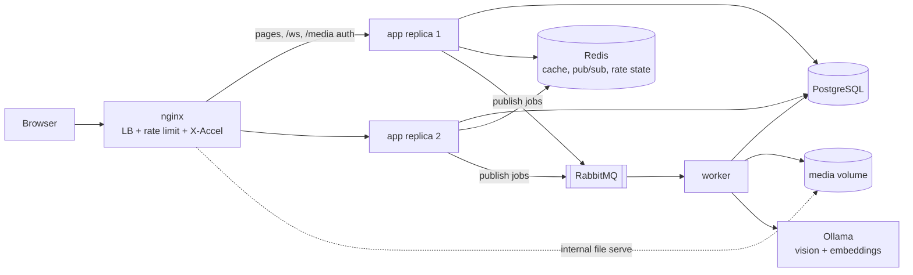
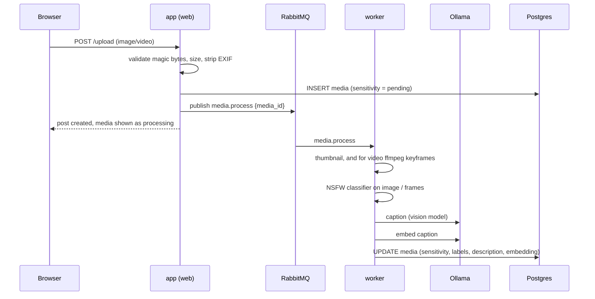

# yourspace

A self-hosted social platform written in Rust. Server-rendered HTML, threaded posts, reposts and stories, public/private accounts with per-feature visibility controls, media with automatic sensitive-content filtering, realtime chat, and a mod/admin toolset. Anyone can browse public content without an account. Everything runs in Docker.

---

## 1. Decisions at a glance

| Question | Decision | Why |
|---|---|---|
| Database | **PostgreSQL** (+ `pgvector`, `pg_trgm`) | Your data is relational. Follows are a 1-hop edge table, threads are a `parent_id` tree. Postgres also gives you full-text search, vector search, transactions for counters/polls and one thing to back up. Neo4j adds a second store that must be kept in sync, for graph queries you don't have yet. |
| Neo4j? | **Not now** | Revisit only for "people you may know" / graph recommendations at very large edge counts. It can be added later as a read-only projection fed from Postgres. |
| Message queue | **RabbitMQ for background jobs only** | Moderation, captioning, embeddings, thumbnails, transcoding. Not for chat delivery. |
| Realtime chat | **WebSocket on the app + Redis pub/sub** | App is horizontally scaled, so a message received by replica A must reach a user connected to replica B. Messages are persisted in Postgres first, then published. |
| Cache | **Both, layered**: `moka` (in-process L1) + **Redis** (shared L2) | L1 is nanoseconds but per-replica. L2 is shared across replicas and also holds rate-limit state and pub/sub. See §6. |
| Load balancer | **nginx** (don't write your own) | Battle-tested, handles WebSocket upgrade, rate limiting, caching and `X-Accel-Redirect` file serving. |
| Frontend | **Server-rendered HTML (Askama templates) + HTMX** + small vanilla JS | Matches your "render and send" goal. JS only for emoji autocomplete, tag chips, WebSocket glue. |
| Media storage | **Shared Docker volume**, served by nginx | Simple. Switch to MinIO/S3 when you outgrow a single host. |
| Media/AI | **Ollama**: vision model for captions + text embedding model for search | Plus a dedicated NSFW classifier for the actual hide/show decision (see §7). |
| Anonymous browsing | **Allowed**, read-only, public content only | Logged-out visitors see what the visibility rules allow (§3.3). Responses for visitors without a session cookie can be cached by nginx (§6). |
| Privacy model | **One `is_private` flag + independent per-feature visibility toggles** | Private only changes the *defaults* (everything hidden, follow approval on). Every toggle can still be flipped individually, so a private account can show everything and a public one can hide anything (§3.2). |
| Friends | **Derived, not stored** | Two accepted follows in opposite directions. No extra table to keep in sync (§3.4). |
| Block / mute | **Separate `blocks` and `mutes` tables** | Block hides everything in both directions, mute only quiets feeds and stories (§3.5). |
| Reports | **`reports` table + mod queue** | Users report posts, AI flags land in the same queue (§7). |

---

## 2. Architecture



Two Rust binaries in one Cargo workspace:

- **`web`**: axum HTTP + WebSocket, renders HTML, enforces auth/roles, publishes jobs.
- **`worker`**: consumes RabbitMQ, calls Ollama / ffmpeg, writes results to Postgres.

Suggested crates: `axum`, `tokio`, `tower-http`, `sqlx` (Postgres, compile-time checked), `askama`, `pulldown-cmark` + `ammonia` (markdown, sanitized), `argon2`, `lapin` (RabbitMQ), `redis`/`deadpool-redis`, `moka`, `reqwest` (Ollama), `image`, `tracing`.

---

## 3. Roles, privacy and visibility

### 3.1 Roles and permissions

| Action | user | mod | admin |
|---|:--:|:--:|:--:|
| Post, reply, like, follow, vote, chat | ✅ | ✅ | ✅ |
| Edit/delete **own** posts, profile, settings | ✅ | ✅ | ✅ |
| See view-deleted posts | ❌ | ✅ | ✅ |
| View-delete any post (soft delete) | ❌ | ✅ | ✅ |
| Restore a view-deleted post | ❌ | ✅ | ✅ |
| Hard-delete a post (row removed) | ❌ | ❌ | ✅ |
| Admin panel | ❌ | ❌ | ✅ |
| Edit any account (name, bio, pic, role, suspend), see who they follow | ❌ | ❌ | ✅ |
| See extra post info (IP/session, moderation labels, audit trail) | ❌ | ❌ | ✅ |
| Repost, post stories, block / mute accounts | ✅ | ✅ | ✅ |
| Report a post | ✅ | ✅ | ✅ |
| Review the report queue and AI-flagged posts, resolve or dismiss reports | ❌ | ✅ | ✅ |
| View-delete a story | ❌ | ✅ | ✅ |
| See posts / likes / follows / reposts / stories that an account has **hidden** | ❌ (own account only) | ❌ | ✅ |

**View-delete** = `posts.deleted_at` is set. Normal queries use the `public_posts` view (`deleted_at IS NULL`); mods and admins query `posts` directly. **Hard delete** removes the row; `ON DELETE CASCADE` cleans up replies, likes, tags, media links. Every mod/admin action writes to `audit_log`.

Mods are ordinary users when it comes to **hidden profile sections** (last row above). They can still act on a specific post that reaches them through the report queue or an AI flag, but only that post.

Role and visibility checks are enforced in one place (an axum extractor plus a single `Viewer` value, `Anonymous | User { id, role }`, passed into every query function), never only in templates and never re-implemented per handler.

### 3.2 Account privacy

Two independent things, stored in `user_privacy`:

- **`is_private`**: a flag that only decides the *defaults* below.
- **Visibility toggles** (`show_posts`, `show_likes`, `show_follows`, `show_reposts`, `show_stories`) plus **`require_follow_approval`**. Each one is set individually, no matter what `is_private` says.

| Setting | Public default | Private default |
|---|---|---|
| Name, username, bio, date joined | always visible | always visible |
| `show_posts`, `show_likes`, `show_follows`, `show_reposts`, `show_stories` | on (shown) | off (hidden) |
| `require_follow_approval` | off | on |

So a private account that shows everything is valid, and so is a public account that hides its likes.

**Future features:** when a new visibility toggle is added later, its column is backfilled with `NOT is_private`. Private accounts hide the new thing, public accounts show it, and everyone can change it afterwards.

**Registration:** right after sign-up the user is redirected to `/welcome/privacy`, where they pick public or private and adjust the toggles. Until that page is submitted (`privacy_onboarded = false`) the account behaves as private with everything hidden, and logged-in navigation keeps redirecting there. Nothing is exposed by accident if someone closes the tab.

**Public → private later:** a popup lists every toggle (hide posts, likes, follows, reposts, stories, require follow approval, and any future ones), pre-set to the private defaults and editable. Nothing is saved until the user confirms. Existing followers are kept and count as approved. Private → public only flips `is_private`; the toggles keep their current values and can be changed in `/settings/privacy`.

### 3.3 Who can see what

| Viewer | Name, username, bio, date joined | Section whose toggle is **on** | Section whose toggle is **off** |
|---|:--:|:--:|:--:|
| Owner | ✅ | ✅ | ✅ |
| Admin | ✅ | ✅ | ✅ |
| Approved follower | ✅ | ✅ | ✅ only if the owner has `require_follow_approval` on |
| Any other logged-in user, **including mods** | ✅ | ✅ | ❌ |
| Anonymous visitor | ✅ | ✅ | ❌ |
| Blocked either way (§3.5) | ❌ | ❌ | ❌ |

The same predicate, `can_view_section(viewer, owner, section)`, is applied everywhere: profile tabs, feeds, search, discover, direct post links, and thread pages. A reply written by an account that hides its posts is shown in a thread as a collapsed "hidden reply" placeholder so the tree keeps its shape. Counters (like count, repost count) stay visible; the *lists* of who liked or reposted follow the toggles.

### 3.4 Following, approval and friends

- `follows.status` is `pending` or `accepted`. Following an account without approval inserts `accepted` directly. With approval it inserts `pending` and the button shows "Requested" (cancelling deletes the row).
- The owner handles requests in `/follow-requests`. Accept sets `accepted`, decline deletes the row. Pending follows do not count in `follower_count` / `following_count` and give no feed or section access.
- Switching approval off does **not** auto-accept pending requests; they stay in the queue until handled.
- **Friends** = two `accepted` follows in opposite directions. It is derived by query (the `follows (followee_id, follower_id)` index already covers it), shown as a "Friends" badge, and powers the **Friends feed** (§4.3). Unfollowing or blocking ends the friendship.

### 3.5 Block and mute

| | Mute | Block |
|---|---|---|
| Direction | One-way (muter stops seeing the muted account's content) | Both directions: neither side can see the other |
| Posts and stories | Hidden from feeds, discover, search and the story tray | Hidden everywhere |
| Replies in threads | Still shown (assumption, see §15) | Hidden: you cannot see them in a comment section, and they cannot see yours |
| Profile | Still visitable | Not visitable (behaves as not found) |
| Follows | Kept | Removed in both directions, and neither can follow again |
| Chat | Unaffected | No new DMs in either direction; any existing conversation is hidden from the blocker and read-only for the blocked user |
| Notified | No | No |

Implementation: every query that returns posts, stories, users or messages goes through the same `Viewer` filter, which does `NOT EXISTS` against `blocks` (and `mutes` for feeds). Each user's block and mute ID sets are cached in Redis and invalidated on change. Cached post fragments stay viewer-agnostic; the filtering happens before rendering (§6).

### 3.6 Anonymous visitors

Logged-out users can browse public content: home and discover feeds, public profiles, post and thread pages, tags and search. They are read-only (no likes, follows, reposts, polls, chat). Visibility rules (§3.3) apply as for any non-follower. Visitors have no settings, so **sensitive media is hidden by default** and can be revealed with the "show" button. Anonymous traffic is rate limited per IP like any other page request (§9).

---

## 4. Data model

### 4.1 ER diagram

```mermaid
erDiagram
    USERS ||--|| USER_SETTINGS : has
    USERS ||--o{ SESSIONS : has
    USERS ||--o{ MEDIA : uploads
    USERS ||--o{ POSTS : writes
    USERS ||--o{ STICKERS : creates
    USERS ||--o{ LIKES : gives
    USERS ||--o{ FOLLOWS : "follower"
    USERS ||--o{ FOLLOWS : "followee"
    USERS ||--o{ POLL_VOTES : casts
    USERS ||--o{ CONVERSATION_MEMBERS : joins
    USERS ||--o{ MESSAGES : sends
    USERS ||--o{ AUDIT_LOG : "acts in"

    USERS ||--|| USER_PRIVACY : has
    USERS ||--o{ REPOSTS : makes
    POSTS ||--o{ REPOSTS : "reposted via"
    USERS ||--o{ STORIES : posts
    STORIES }o--|| MEDIA : uses
    STORIES ||--o{ STORY_VIEWS : "seen via"
    USERS ||--o{ STORY_VIEWS : views
    USERS ||--o{ BLOCKS : "blocker"
    USERS ||--o{ BLOCKS : "blocked"
    USERS ||--o{ MUTES : "muter"
    USERS ||--o{ MUTES : "muted"
    USERS ||--o{ REPORTS : files
    POSTS ||--o{ REPORTS : "reported in"

    POSTS ||--o{ POSTS : "parent of"
    POSTS ||--o{ LIKES : receives
    POSTS ||--o{ POST_MEDIA : has
    MEDIA ||--o{ POST_MEDIA : "attached via"
    POSTS ||--o{ POST_STICKERS : has
    STICKERS ||--o{ POST_STICKERS : "used in"
    STICKERS }o--|| MEDIA : "image is"
    POSTS ||--o{ POST_TAGS : has
    TAGS ||--o{ POST_TAGS : "applied via"
    POSTS ||--o| POLLS : "may be"
    POLLS ||--o{ POLL_OPTIONS : has
    POLL_OPTIONS ||--o{ POLL_VOTES : receives

    CONVERSATIONS ||--o{ CONVERSATION_MEMBERS : has
    CONVERSATIONS ||--o{ MESSAGES : contains
    MESSAGES }o--o| MEDIA : "may attach"
    MESSAGES }o--o| STICKERS : "may use"

    USERS {
        bigint id PK
        citext username UK
        text display_name
        citext email UK
        text password_hash
        text bio
        bigint avatar_media_id FK
        user_role role "user | mod | admin"
        bool is_suspended
        int follower_count
        int following_count
        timestamptz created_at
    }
    USER_SETTINGS {
        bigint user_id PK, FK
        bool hide_sensitive
        text dm_policy
        text language
        text theme
        bool hide_typing_indicator "hides mine and theirs in my chats"
        jsonb extra
    }
    USER_PRIVACY {
        bigint user_id PK, FK
        bool is_private "only changes the defaults"
        bool require_follow_approval
        bool show_posts
        bool show_likes
        bool show_follows
        bool show_reposts
        bool show_stories
        bool privacy_onboarded "false until the welcome page is submitted"
    }
    SESSIONS {
        bytea token_hash PK
        bigint user_id FK
        timestamptz expires_at
        inet ip
        text user_agent
    }
    MEDIA {
        bigint id PK
        bigint owner_id FK
        media_kind kind "image | video"
        text mime
        text storage_key UK
        text thumbnail_key
        bigint size_bytes
        int width
        int height
        int duration_ms
        bytea sha256
        sensitivity_state sensitivity "pending | safe | sensitive | blocked"
        jsonb moderation_labels
        text moderation_model
        text description "AI caption, searchable"
        tsvector description_tsv
        vector description_embedding
        timestamptz processed_at
    }
    POSTS {
        bigint id PK
        bigint author_id FK
        bigint parent_id FK "NULL = thread start"
        bigint root_id FK "thread root, set by trigger"
        int depth
        text body_md
        text body_html "sanitized render"
        int like_count
        int reply_count
        int repost_count
        timestamptz created_at
        timestamptz edited_at
        timestamptz deleted_at "view-delete marker"
        bigint deleted_by FK
        text delete_reason
        sensitivity_state sensitivity "worst of text and media verdicts"
        jsonb moderation_labels "raw LLM output"
        text moderation_model
        timestamptz moderation_checked_at
        tsvector search_tsv
    }
    POST_MEDIA {
        bigint post_id PK, FK
        bigint media_id PK, FK
        smallint position
    }
    STICKERS {
        bigint id PK
        bigint owner_id FK "NULL = built-in"
        text name
        bigint media_id FK
    }
    POST_STICKERS {
        bigint post_id PK, FK
        bigint sticker_id PK, FK
        smallint position PK
    }
    TAGS {
        bigint id PK
        citext name UK
    }
    POST_TAGS {
        bigint post_id PK, FK
        bigint tag_id PK, FK
    }
    POLLS {
        bigint post_id PK, FK
        bool allow_multiple
        timestamptz closes_at
    }
    POLL_OPTIONS {
        bigint id PK
        bigint poll_id FK
        text label
        smallint position
        int vote_count
    }
    POLL_VOTES {
        bigint option_id PK, FK
        bigint user_id PK, FK
        bigint poll_id FK
    }
    LIKES {
        bigint user_id PK, FK
        bigint post_id PK, FK
        timestamptz created_at
    }
    FOLLOWS {
        bigint follower_id PK, FK
        bigint followee_id PK, FK
        follow_status status "pending | accepted"
        timestamptz created_at
    }
    REPOSTS {
        bigint user_id PK, FK
        bigint post_id PK, FK
        timestamptz created_at
    }
    STORIES {
        bigint id PK
        bigint author_id FK
        bigint media_id FK
        text caption
        timestamptz created_at
        timestamptz expires_at "created_at plus 24h"
        timestamptz deleted_at "view-delete marker"
        bigint deleted_by FK
    }
    STORY_VIEWS {
        bigint story_id PK, FK
        bigint viewer_id PK, FK
        timestamptz viewed_at
    }
    BLOCKS {
        bigint blocker_id PK, FK
        bigint blocked_id PK, FK
        timestamptz created_at
    }
    MUTES {
        bigint muter_id PK, FK
        bigint muted_id PK, FK
        timestamptz created_at
    }
    REPORTS {
        bigint id PK
        bigint reporter_id FK
        bigint post_id FK
        text reason
        text details
        report_status status "open | resolved | dismissed"
        bigint resolved_by FK
        timestamptz resolved_at
        timestamptz created_at
    }
    CONVERSATIONS {
        bigint id PK
        conversation_kind kind "direct | group"
        text title
        text direct_key UK "prevents duplicate 1:1 chats"
        bigint created_by FK
    }
    CONVERSATION_MEMBERS {
        bigint conversation_id PK, FK
        bigint user_id PK, FK
        bigint last_read_message_id "read receipts"
        bool muted
    }
    MESSAGES {
        bigint id PK
        bigint conversation_id FK
        bigint sender_id FK
        text body
        bigint media_id FK
        bigint sticker_id FK
        timestamptz created_at
        timestamptz deleted_at
    }
    AUDIT_LOG {
        bigint id PK
        bigint actor_id FK
        text action
        text target_type
        bigint target_id
        text reason
        jsonb meta
        timestamptz created_at
    }
```



The full DDL (types, constraints, indexes, thread trigger, `public_posts` view) is in [`schema.sql`](schema.sql). **Note:** `schema.sql` still describes the first version of the model. The tables and columns added in this revision (`user_privacy`, `reposts`, `stories`, `story_views`, `blocks`, `mutes`, `reports`, `follows.status`, the `posts` moderation fields, `user_settings.hide_typing_indicator`) have to be added to it.

### 4.2 Modeling notes

- **Threads**: every post has `parent_id` (NULL for a thread start). `root_id` and `depth` are filled by a trigger, so loading a whole thread is one query: `WHERE root_id = $1 ORDER BY created_at`, then build the tree in Rust. No recursive CTE per request. A `depth <= 50` check stops pathological chains.
- **Hidden content descriptions**: stored in `media.description`. The template renders it both as the `alt` attribute and as a visually-hidden element next to the media (readable by crawlers, screen readers and inspect-element).
- **Tags**: stored normalized (`tags` + `post_tags`). The UI turns `#something␣` into a chip with an `[x]` and sends the final tag list as form fields; the server re-parses and validates, so the client is never trusted.
- **Polls**: a poll is a post with a `polls` row. `poll_options.vote_count` is a denormalized counter updated in the vote transaction.
- **Counters** (`like_count`, `reply_count`, `repost_count`, `follower_count`, `following_count`, `vote_count`) are denormalized for fast reads and updated in the same transaction as the row they count. Follower counters count `accepted` follows only.
- **Read receipts**: one `last_read_message_id` per member, not a row per message.
- **Typing indicators** are never stored; they're ephemeral WebSocket events fanned out over Redis pub/sub and throttled.
- **Emojis** are stored as plain Unicode. `:joy:` autocomplete is frontend-only and inserts the Unicode character, so the DB and search need nothing special.
- **Stickers** are `media` rows wrapped by `stickers`, allowed in posts (`post_stickers`) and chat (`messages.sticker_id`).
- **IDs** are `BIGINT` identity columns (small indexes, keyset pagination). If you later want non-enumerable public IDs, add a separate `public_id` column rather than switching primary keys.
- **Privacy**: `user_privacy` is a 1:1 table (one row per user, created at registration in the same transaction). It is read on almost every request, so it is cached in `moka`/Redis and invalidated on change. Adding a toggle = new column, backfilled with `NOT is_private` (§3.2).
- **Follows** carry a `status` (`pending` | `accepted`). A decline or a cancelled request deletes the row. **Friends** are never stored; they are the self-join of two `accepted` rows.
- **Reposts**: a plain `(user_id, post_id)` row, no quote text. Reposts show up in feeds as "X reposted" and in the reposter's profile when `show_reposts` allows it. Posts from private accounts cannot be reposted, because a repost would expose them outside the account's own visibility rules.
- **Stories**: media-only (plus optional caption) posts that expire. `expires_at = created_at + 24h`; readers filter on `expires_at > now()`, and a worker purges expired rows and their media after a retention period. Stories go through the same media pipeline as posts, carry the same `deleted_at` view-delete marker, and `story_views` records who has seen each one.
- **Blocks and mutes**: two small edge tables with composite primary keys and `CHECK (a <> b)`. Block is symmetric in effect but stored once, as `(blocker_id, blocked_id)`.
- **Reports**: one row per `(reporter_id, post_id)` (unique), with `status` `open | resolved | dismissed`. Resolving can trigger a view-delete; both are written to `audit_log`.
- **AI sensitivity flags**: `posts.sensitivity` is the worst verdict across the post's text (LLM text check) and its attached media (`media.sensitivity`), recomputed by the worker whenever a check finishes. `moderation_labels` keeps the raw labels/scores, and `moderation_model` + `moderation_checked_at` record which model decided and when, so verdicts can be re-run after a model change. `sensitive` posts are blurred for users with `hide_sensitive` on; `blocked` posts are withheld from everyone except the owner, mods and admins until reviewed. `sensitive` and `blocked` posts appear in the mod queue next to user reports. Media (and therefore stories and chat media) carries the same fields.

### 4.3 Feeds

| Feed | Query strategy |
|---|---|
| Following | Fan-out **on read**: `posts WHERE author_id IN (accepted followees) ORDER BY id DESC`, keyset pagination. Cache the ID list in Redis for a few seconds. Includes reposts made by followees. |
| Friends | Same as Following, restricted to mutual follows: join `follows` to itself (`a.follower_id = $viewer AND b.followee_id = $viewer AND a.followee_id = b.follower_id AND both accepted`) and take posts by those authors. Only friends' posts, no discover mixing. |
| Discover | Score = likes and replies with time decay, computed by a periodic job into a Redis sorted set. |
| FYP | Later. Start by blending Following + Discover; add personalization once you have engagement data. |

Fan-out on write (precomputed timelines) only becomes worthwhile when accounts have huge follower counts.

Every feed applies the visibility predicate from §3.3 (hidden `show_posts` / `show_reposts`) and the viewer's blocks and mutes. Stories are not part of the feeds; they appear in a story tray built from followees with an unexpired story, minus blocked and muted accounts and accounts whose `show_stories` is off for that viewer.

---

## 5. Search

1. **Keyword**: `posts.search_tsv` (post text) and `media.description_tsv` (AI captions) with GIN indexes, plus tag matching. Uses the `simple` text-search config so it works for any language; switch to per-language configs if you want stemming.
2. **Semantic**: the worker embeds each caption with an Ollama embedding model (e.g. `nomic-embed-text`, 768-dim, matches `VECTOR(768)`), stored in `media.description_embedding` with an HNSW index. At query time embed the query and merge the top results with keyword results.
3. **CLIP note**: Ollama doesn't serve CLIP-style image-text embeddings well. "VLM caption → text embedding" works fully inside Ollama. True CLIP can be added later in the worker via ONNX (`ort` crate) if caption search isn't good enough.
4. **Videos**: ffmpeg extracts a handful of keyframes; caption those and join the captions.
5. **Who may see a result**: search results go through the same visibility predicate, blocks and mutes as feeds (§3.3, §3.5). Hidden posts, and posts from blocked accounts, are filtered out of results, including the captions and tags derived from them.

---

## 6. Caching

| Layer | What | TTL |
|---|---|---|
| nginx `proxy_cache` | `/static/*` | 1 h |
| nginx `proxy_cache` (anonymous only, **planned**, not in `nginx.conf` yet) | public pages for requests with no session cookie, keyed by URL; bypassed whenever a session cookie is present | 15 s |
| `moka` (in-process, L1) | hot user cards, rendered post fragments, role/settings lookups | 5-30 s |
| Redis (shared, L2) | feed ID lists, counters, discover sets, rate-limit state, session lookups | seconds to minutes |
| Postgres | source of truth | n/a |

Rules: cache **post fragments** keyed by `(post_id, edited_at)` and apply per-viewer concerns (sensitive-media blur, view-delete visibility) at render time, not inside the cached fragment. Invalidate on edit/delete by deleting the key and publishing an invalidation on Redis pub/sub so every replica drops its L1 copy.

---

## 7. Media upload and moderation pipeline



- **Pending media is hidden from everyone but the owner** until classified. No window where unmoderated content is publicly visible.
- **Hide-for-users-who-enabled-it**: if `user_settings.hide_sensitive` is true and `media.sensitivity = 'sensitive'`, the server renders a placeholder with a "show" button (HTMX swap) and **does not send the bytes**. `/media/:id` is the enforcement point: the app authorizes, then replies with `X-Accel-Redirect` so nginx streams the file.
- **Classifier choice**: a general vision LLM is a weak and slow NSFW detector. Use a dedicated lightweight NSFW image classifier (ONNX via the `ort` crate or a small sidecar) for the decision, and use the Ollama vision model for captions and as a second opinion on borderline scores. Check the current model options in the Ollama library when you pick; the compose file defaults to `moondream` + `nomic-embed-text` as a starting point.
- **Videos**: classify N keyframes (e.g. 1 per 2 s, capped); sensitive if any frame crosses the threshold. Transcode to H.264/MP4 with a size/duration cap.
- **Upload limit**: videos are capped at **50 MB**. The app rejects larger files, and `client_max_body_size` in `nginx.conf` (currently `100m`) must be lowered to match.
- **Text and post-level flags**: the worker also runs the post text through an Ollama LLM check. The result is combined with the media verdicts into `posts.sensitivity` and stored with its raw labels, model name and timestamp (§4.2). Text-only posts are visible immediately and get their verdict within seconds; posts with media stay hidden from everyone but the owner until their media is classified.
- **Flag handling**: `sensitive` posts are blurred for users with `hide_sensitive` on (and for anonymous visitors). `sensitive` and `blocked` posts are queued for mods, together with user reports. A mod resolving a report can view-delete the post, and both actions are written to `audit_log`.

---

## 8. Chat

- WebSocket at `/ws` (nginx upgrades it, 1 h read timeout).
- **Send**: validate membership → `INSERT messages` → publish on Redis channel `conv:{id}` → every replica forwards to its connected members.
- **Read receipt**: client reports the last visible message → `UPDATE conversation_members.last_read_message_id` → publish.
- **Typing**: client event (throttled ~1/3 s) → Redis pub/sub only. If any member of a conversation has `hide_typing_indicator` on, typing events are suppressed in that conversation both ways: their own indicator is not sent, and they do not receive the others'. In a 1:1 chat that means neither side sees an indicator. In a group, only the members who turned it on are affected.
- **Blocks and DM policy**: a message is accepted only if neither side has blocked the other and the recipient's `dm_policy` allows the sender (§3.5).
- **Offline users** get messages on next load via `messages (conversation_id, id DESC)` keyset pagination.
- Media and stickers in chat go through the same upload and moderation pipeline as posts.

---

## 9. Rate limiting

Two layers:

1. **nginx** (`limit_req`, per IP), configured in [`nginx.conf`](nginx.conf):
   - pages: **5 r/s**, burst 20 (stricter)
   - media/static: **100 r/s**, burst 300 (you'd have to spam very hard)
   - login/register: **5 r/min**, burst 5
2. **App-level, per user/session** (Redis counters, e.g. `governor`-style): posting, liking, following, DMs and uploads. IP limits alone punish shared networks and don't stop one logged-in account.

Anonymous visitors are covered by the same per-IP limits as everyone else. Their cached responses (§6) mostly never reach the app, so the limits mainly protect uncached and logged-in traffic.

> Interpretation: you wrote "tiny for media, bigger for pages". I read it as *media = very lenient limit, pages = tighter limit*. If you meant the opposite, swap the two `rate=` values.

---

## 10. Pages and routes

| Area | Pages |
|---|---|
| Public (no login needed) | `/` feed, `/discover`, `/search?q=`, `/tag/:name`, `/p/:id` post + full thread, `/u/:username` profile (what the visibility rules allow) |
| Auth | `/login`, `/register`, `/welcome/privacy` (public/private choice and toggles, shown right after registration) |
| Posts | compose (markdown, media, stickers, poll, tags), repost, report |
| Stories | story tray, `/stories/:username`, create story |
| Feeds | `/following`, `/friends` (mutual follows only), `/discover` |
| Account | `/settings` (profile edit, hide sensitive, DM policy, theme, hide typing indicator), `/settings/privacy` (public/private, visibility toggles, follow approval), `/follow-requests`, `/blocked` (blocks and mutes), `/stickers` (create/manage) |
| Chat | `/chat`, `/chat/:id`, `/ws` |
| Mod | view-delete / restore on any post or story; report queue and AI-flagged posts |
| Admin | `/admin` dashboard, `/admin/users/:id` (edit anything, role, suspend, follow list), `/admin/posts/:id` (extra info, hard delete), audit log |

---

## 11. Enterprise-grade checklist

- **Auth**: argon2id, opaque session cookies (store only a hash), `HttpOnly; Secure; SameSite=Lax`, CSRF tokens on all forms, session rotation on login.
- **Input**: markdown rendered with `pulldown-cmark` then sanitized with `ammonia`; strict CSP; parameterized queries only (sqlx).
- **Uploads**: verify magic bytes (not the extension), re-encode images and strip EXIF, enforce size/duration caps (video max 50 MB), random storage keys, never serve from a user-controlled path.
- **Ops**: structured logs (`tracing`), `/healthz`, Prometheus metrics, Postgres backups (nightly `pg_dump` + WAL archiving), migrations via `sqlx migrate`.
- **Visibility tests**: privacy is the easiest thing to leak by accident, so keep an automated test matrix of viewer type (owner, admin, approved follower, other user, mod, anonymous, blocked) × section toggle (on/off) × account type, run against every endpoint that returns posts, likes, follows, reposts or stories.
- **Secrets**: `.env` locally, Docker/Swarm/Kubernetes secrets in production. Never commit `.env`.
- **Operational note**: Ollama on CPU is slow. Moderation is async by design, so slowness delays *visibility*, not requests. Use a GPU for real traffic.

---

## 12. Repository layout

```
.
├── README.md
├── docker-compose.yml
├── .env.example
├── Dockerfile.app          # targets: web, worker
├── Dockerfile.postgres
├── Dockerfile.nginx
├── Dockerfile.ollama
├── ollama-entrypoint.sh
├── nginx.conf
├── schema.sql              # initial schema → becomes migrations/0001_init.sql
├── Cargo.toml              # workspace (to be created)
├── crates/
│   ├── web/                # axum server, templates
│   ├── worker/             # RabbitMQ consumers
│   └── core/               # models, db, shared logic
├── templates/              # Askama templates
└── static/                 # css, js, built-in stickers
```

---

## 13. Running it

```bash
cp .env.example .env        # set real secrets
docker compose up --build   # nginx on http://localhost
docker compose up -d --scale app=4 && docker compose restart nginx   # more replicas
```

The `app`/`worker` images won't build until the Cargo workspace (`web` and `worker` binaries) and a `static/` directory exist. Postgres, Redis, RabbitMQ, Ollama and nginx can be brought up on their own: `docker compose up db redis rabbitmq ollama`.

---

## 14. Roadmap

| Phase | Scope |
|---|---|
| 0 Foundations | Cargo workspace, compose stack up, migrations, `/healthz`, CI |
| 1 Core | Register/login, sessions, profiles, settings, `/welcome/privacy` onboarding, anonymous browsing of public content, text posts + markdown, likes, basic follows |
| 2 Privacy and social graph | `user_privacy` + visibility toggles, public → private popup, follow approval and `/follow-requests`, friends + friends feed, block and mute, the central `Viewer` visibility filter and its test matrix. Done early because every later query depends on it |
| 3 Threads and tags | `parent_id` replies, thread view, tags with chip UI, search by keyword |
| 4 Media | Uploads (video max 50 MB), pipeline (thumbnail, NSFW, caption, embedding), hide-sensitive, semantic search |
| 5 Extras | Stickers, polls, emoji autocomplete, reposts, stories, discover feed |
| 6 Chat | WebSocket, persistence, Redis fan-out, read receipts, typing (with hide-typing setting), chat media |
| 7 Moderation | Mod role, view-delete/restore (posts and stories), report post, AI flags on posts and the mod queue, admin panel, hard delete, audit log |
| 8 Hardening | L1/L2 caching incl. anonymous page cache, app-level rate limits, metrics, backups, load testing |
| 9 Scale | MinIO/S3, Postgres read replicas, dedicated search/GPU nodes if needed |
| Maybe | Content compression worker, Kubernetes (see §15) |

---

## 15. Open questions and maybes

### Decided in this revision

Reposts, stories, anonymous browsing, public/private accounts with per-feature toggles, follow approval, friends and the friends feed, block and mute, post reports, AI sensitivity flags, the hide-typing-indicator setting and the 50 MB video cap are all part of the plan (§3 to §10). Earlier open questions on browsing, approval and block/mute/report are answered by them.

### Open (the README currently assumes the default in brackets)

1. **Do approved followers see hidden sections?** (Yes, but only when the owner has follow approval on; with approval off, a hidden toggle hides from everyone except the owner and admins.) Your notes say hidden stuff is visible to admins only, so confirm this exception for approved followers.
2. **Replies from muted accounts in threads.** (Still shown; mute only affects feeds, discover, search and the story tray.)
3. **Avatar on private profiles.** Your list of always-visible fields is name, username, bio and date joined. (Kept literally, so the avatar is hidden or replaced with a placeholder.)
4. **Private → public behaviour.** (Only flips the flag; toggles are unchanged and pending follow requests stay pending.)
5. **Video duration cap, image size cap, and whether to transcode on upload.** Only the 50 MB video size is decided.

### Maybe

- **Compression worker**: a worker that compresses uploaded content (re-encode video, recompress images). It would also make the 50 MB cap easier to live with.
- **Hosting**: single VPS with Docker Compose now, Kubernetes later?
