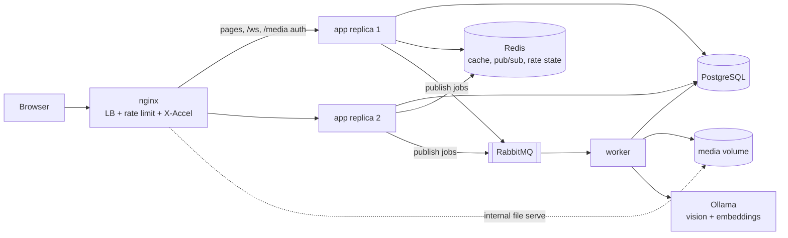
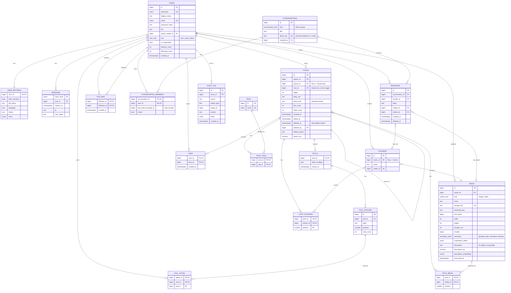
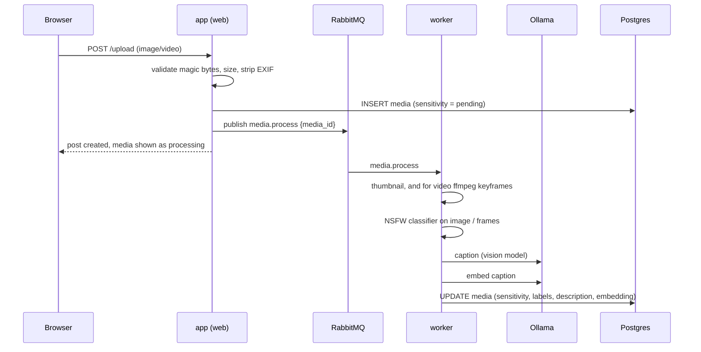

# yourspace

A self-hosted social platform written in Rust. Server-rendered HTML, threaded posts, media with automatic sensitive-content filtering, realtime chat, and a mod/admin toolset. Everything runs in Docker.

---

## 1. Decisions at a glance

| Question | Decision | Why |
|---|---|---|
| Database | **PostgreSQL** (+ `pgvector`, `pg_trgm`) | Your data is relational. Follows are a 1-hop edge table, threads are a `parent_id` tree. Postgres also gives you full-text search, vector search, transactions for counters/polls and one thing to back up. Neo4j adds a second store that must be kept in sync, for graph queries you don't have yet. |
| Neo4j? | **Not now** | Revisit only for "people you may know" / graph recommendations at very large edge counts. It can be added later as a read-only projection fed from Postgres. |
| Message queue | **RabbitMQ for background jobs only** | Moderation, captioning, embeddings, thumbnails, transcoding. Not for chat delivery. |
| Realtime chat | **WebSocket on the app + Redis pub/sub** | App is horizontally scaled, so a message received by replica A must reach a user connected to replica B. Messages are persisted in Postgres first, then published. |
| Cache | **Both, layered**: `moka` (in-process L1) + **Redis** (shared L2) | L1 is nanoseconds but per-replica. L2 is shared across replicas and also holds rate-limit state and pub/sub. See §6. |
| Load balancer | **nginx** (don't write your own) | Battle-tested, handles WebSocket upgrade, rate limiting, caching and `X-Accel-Redirect` file serving. |
| Frontend | **Server-rendered HTML (Askama templates) + HTMX** + small vanilla JS | Matches your "render and send" goal. JS only for emoji autocomplete, tag chips, WebSocket glue. |
| Media storage | **Shared Docker volume**, served by nginx | Simple. Switch to MinIO/S3 when you outgrow a single host. |
| Media/AI | **Ollama**: vision model for captions + text embedding model for search | Plus a dedicated NSFW classifier for the actual hide/show decision (see §7). |

---

## 2. Architecture



Two Rust binaries in one Cargo workspace:

- **`web`**: axum HTTP + WebSocket, renders HTML, enforces auth/roles, publishes jobs.
- **`worker`**: consumes RabbitMQ, calls Ollama / ffmpeg, writes results to Postgres.

Suggested crates: `axum`, `tokio`, `tower-http`, `sqlx` (Postgres, compile-time checked), `askama`, `pulldown-cmark` + `ammonia` (markdown, sanitized), `argon2`, `lapin` (RabbitMQ), `redis`/`deadpool-redis`, `moka`, `reqwest` (Ollama), `image`, `tracing`.

---

## 3. Roles and permissions

| Action | user | mod | admin |
|---|:--:|:--:|:--:|
| Post, reply, like, follow, vote, chat | ✅ | ✅ | ✅ |
| Edit/delete **own** posts, profile, settings | ✅ | ✅ | ✅ |
| See view-deleted posts | ❌ | ✅ | ✅ |
| View-delete any post (soft delete) | ❌ | ✅ | ✅ |
| Restore a view-deleted post | ❌ | ✅ | ✅ |
| Hard-delete a post (row removed) | ❌ | ❌ | ✅ |
| Admin panel | ❌ | ❌ | ✅ |
| Edit any account (name, bio, pic, role, suspend), see who they follow | ❌ | ❌ | ✅ |
| See extra post info (IP/session, moderation labels, audit trail) | ❌ | ❌ | ✅ |

**View-delete** = `posts.deleted_at` is set. Normal queries use the `public_posts` view (`deleted_at IS NULL`); mods and admins query `posts` directly. **Hard delete** removes the row; `ON DELETE CASCADE` cleans up replies, likes, tags, media links. Every mod/admin action writes to `audit_log`.

Role checks are enforced in one place (an axum extractor / middleware), never only in templates.

---

## 4. Data model

### 4.1 ER diagram



The full DDL (types, constraints, indexes, thread trigger, `public_posts` view) is in [`schema.sql`](schema.sql).

### 4.2 Modeling notes

- **Threads**: every post has `parent_id` (NULL for a thread start). `root_id` and `depth` are filled by a trigger, so loading a whole thread is one query: `WHERE root_id = $1 ORDER BY created_at`, then build the tree in Rust. No recursive CTE per request. A `depth <= 50` check stops pathological chains.
- **Hidden content descriptions**: stored in `media.description`. The template renders it both as the `alt` attribute and as a visually-hidden element next to the media (readable by crawlers, screen readers and inspect-element).
- **Tags**: stored normalized (`tags` + `post_tags`). The UI turns `#something␣` into a chip with an `[x]` and sends the final tag list as form fields; the server re-parses and validates, so the client is never trusted.
- **Polls**: a poll is a post with a `polls` row. `poll_options.vote_count` is a denormalized counter updated in the vote transaction.
- **Counters** (`like_count`, `reply_count`, `follower_count`, `vote_count`) are denormalized for fast reads and updated in the same transaction as the row they count.
- **Read receipts**: one `last_read_message_id` per member, not a row per message.
- **Typing indicators** are never stored; they're ephemeral WebSocket events fanned out over Redis pub/sub and throttled.
- **Emojis** are stored as plain Unicode. `:joy:` autocomplete is frontend-only and inserts the Unicode character, so the DB and search need nothing special.
- **Stickers** are `media` rows wrapped by `stickers`, allowed in posts (`post_stickers`) and chat (`messages.sticker_id`).
- **IDs** are `BIGINT` identity columns (small indexes, keyset pagination). If you later want non-enumerable public IDs, add a separate `public_id` column rather than switching primary keys.

### 4.3 Feeds

| Feed | Query strategy |
|---|---|
| Following | Fan-out **on read**: `posts WHERE author_id IN (followees) ORDER BY id DESC`, keyset pagination. Cache the ID list in Redis for a few seconds. |
| Discover | Score = likes and replies with time decay, computed by a periodic job into a Redis sorted set. |
| FYP | Later. Start by blending Following + Discover; add personalization once you have engagement data. |

Fan-out on write (precomputed timelines) only becomes worthwhile when accounts have huge follower counts.

---

## 5. Search

1. **Keyword**: `posts.search_tsv` (post text) and `media.description_tsv` (AI captions) with GIN indexes, plus tag matching. Uses the `simple` text-search config so it works for any language; switch to per-language configs if you want stemming.
2. **Semantic**: the worker embeds each caption with an Ollama embedding model (e.g. `nomic-embed-text`, 768-dim, matches `VECTOR(768)`), stored in `media.description_embedding` with an HNSW index. At query time embed the query and merge the top results with keyword results.
3. **CLIP note**: Ollama doesn't serve CLIP-style image-text embeddings well. "VLM caption → text embedding" works fully inside Ollama. True CLIP can be added later in the worker via ONNX (`ort` crate) if caption search isn't good enough.
4. **Videos**: ffmpeg extracts a handful of keyframes; caption those and join the captions.

---

## 6. Caching

| Layer | What | TTL |
|---|---|---|
| nginx `proxy_cache` | `/static/*` | 1 h |
| `moka` (in-process, L1) | hot user cards, rendered post fragments, role/settings lookups | 5-30 s |
| Redis (shared, L2) | feed ID lists, counters, discover sets, rate-limit state, session lookups | seconds to minutes |
| Postgres | source of truth | n/a |

Rules: cache **post fragments** keyed by `(post_id, edited_at)` and apply per-viewer concerns (sensitive-media blur, view-delete visibility) at render time, not inside the cached fragment. Invalidate on edit/delete by deleting the key and publishing an invalidation on Redis pub/sub so every replica drops its L1 copy.

---

## 7. Media upload and moderation pipeline



- **Pending media is hidden from everyone but the owner** until classified. No window where unmoderated content is publicly visible.
- **Hide-for-users-who-enabled-it**: if `user_settings.hide_sensitive` is true and `media.sensitivity = 'sensitive'`, the server renders a placeholder with a "show" button (HTMX swap) and **does not send the bytes**. `/media/:id` is the enforcement point: the app authorizes, then replies with `X-Accel-Redirect` so nginx streams the file.
- **Classifier choice**: a general vision LLM is a weak and slow NSFW detector. Use a dedicated lightweight NSFW image classifier (ONNX via the `ort` crate or a small sidecar) for the decision, and use the Ollama vision model for captions and as a second opinion on borderline scores. Check the current model options in the Ollama library when you pick; the compose file defaults to `moondream` + `nomic-embed-text` as a starting point.
- **Videos**: classify N keyframes (e.g. 1 per 2 s, capped); sensitive if any frame crosses the threshold. Transcode to H.264/MP4 with a size/duration cap.

---

## 8. Chat

- WebSocket at `/ws` (nginx upgrades it, 1 h read timeout).
- **Send**: validate membership → `INSERT messages` → publish on Redis channel `conv:{id}` → every replica forwards to its connected members.
- **Read receipt**: client reports the last visible message → `UPDATE conversation_members.last_read_message_id` → publish.
- **Typing**: client event (throttled ~1/3 s) → Redis pub/sub only.
- **Offline users** get messages on next load via `messages (conversation_id, id DESC)` keyset pagination.
- Media and stickers in chat go through the same upload and moderation pipeline as posts.

---

## 9. Rate limiting

Two layers:

1. **nginx** (`limit_req`, per IP), configured in [`nginx.conf`](nginx.conf):
   - pages: **5 r/s**, burst 20 (stricter)
   - media/static: **100 r/s**, burst 300 (you'd have to spam very hard)
   - login/register: **5 r/min**, burst 5
2. **App-level, per user/session** (Redis counters, e.g. `governor`-style): posting, liking, following, DMs and uploads. IP limits alone punish shared networks and don't stop one logged-in account.

> Interpretation: you wrote "tiny for media, bigger for pages". I read it as *media = very lenient limit, pages = tighter limit*. If you meant the opposite, swap the two `rate=` values.

---

## 10. Pages and routes

| Area | Pages |
|---|---|
| Public/auth | `/` feed, `/login`, `/register`, `/u/:username` profile (bio, pic, posts, followers/following) |
| Posts | `/p/:id` post + full thread, compose (markdown, media, stickers, poll, tags), `/tag/:name` |
| Discovery | `/following`, `/discover`, `/search?q=` (posts, captions, tags) |
| Account | `/settings` (profile edit, hide sensitive, DM policy, theme), `/stickers` (create/manage) |
| Chat | `/chat`, `/chat/:id`, `/ws` |
| Mod | view-delete / restore on any post; moderation queue |
| Admin | `/admin` dashboard, `/admin/users/:id` (edit anything, role, suspend, follow list), `/admin/posts/:id` (extra info, hard delete), audit log |

---

## 11. Enterprise-grade checklist

- **Auth**: argon2id, opaque session cookies (store only a hash), `HttpOnly; Secure; SameSite=Lax`, CSRF tokens on all forms, session rotation on login.
- **Input**: markdown rendered with `pulldown-cmark` then sanitized with `ammonia`; strict CSP; parameterized queries only (sqlx).
- **Uploads**: verify magic bytes (not the extension), re-encode images and strip EXIF, enforce size/duration caps, random storage keys, never serve from a user-controlled path.
- **Ops**: structured logs (`tracing`), `/healthz`, Prometheus metrics, Postgres backups (nightly `pg_dump` + WAL archiving), migrations via `sqlx migrate`.
- **Secrets**: `.env` locally, Docker/Swarm/Kubernetes secrets in production. Never commit `.env`.
- **Operational note**: Ollama on CPU is slow. Moderation is async by design, so slowness delays *visibility*, not requests. Use a GPU for real traffic.

---

## 12. Repository layout

```
.
├── README.md
├── docker-compose.yml
├── .env.example
├── Dockerfile.app          # targets: web, worker
├── Dockerfile.postgres
├── Dockerfile.nginx
├── Dockerfile.ollama
├── ollama-entrypoint.sh
├── nginx.conf
├── schema.sql              # initial schema → becomes migrations/0001_init.sql
├── Cargo.toml              # workspace (to be created)
├── crates/
│   ├── web/                # axum server, templates
│   ├── worker/             # RabbitMQ consumers
│   └── core/               # models, db, shared logic
├── templates/              # Askama templates
└── static/                 # css, js, built-in stickers
```

---

## 13. Running it

```bash
cp .env.example .env        # set real secrets
docker compose up --build   # nginx on http://localhost
docker compose up -d --scale app=4 && docker compose restart nginx   # more replicas
```

The `app`/`worker` images won't build until the Cargo workspace (`web` and `worker` binaries) and a `static/` directory exist. Postgres, Redis, RabbitMQ, Ollama and nginx can be brought up on their own: `docker compose up db redis rabbitmq ollama`.

---

## 14. Roadmap

| Phase | Scope |
|---|---|
| 0 Foundations | Cargo workspace, compose stack up, migrations, `/healthz`, CI |
| 1 Core | Register/login, sessions, profiles, settings, text posts + markdown, likes, follows, following feed |
| 2 Threads and tags | `parent_id` replies, thread view, tags with chip UI, search by keyword |
| 3 Media | Uploads, pipeline (thumbnail, NSFW, caption, embedding), hide-sensitive, semantic search |
| 4 Extras | Stickers, polls, emoji autocomplete, discover feed |
| 5 Chat | WebSocket, persistence, Redis fan-out, read receipts, typing, chat media |
| 6 Moderation | Mod role, view-delete/restore, admin panel, hard delete, audit log |
| 7 Hardening | L1/L2 caching, app-level rate limits, metrics, backups, load testing |
| 8 Scale | MinIO/S3, Postgres read replicas, dedicated search/GPU nodes if needed |

---

## 15. Open questions

1. Public or login-required to browse? (Affects nginx caching of anonymous pages.)
2. Should following be one-way (current model) or mutual/approval-based for private accounts?
3. Block/mute and report-a-post features: not in your list, but strongly recommended before launch. Easy to add as `blocks` and `reports` tables.
4. Video limits: max length/size and whether to transcode on upload.
5. Hosting target: single VPS with Docker Compose, or Kubernetes later?
